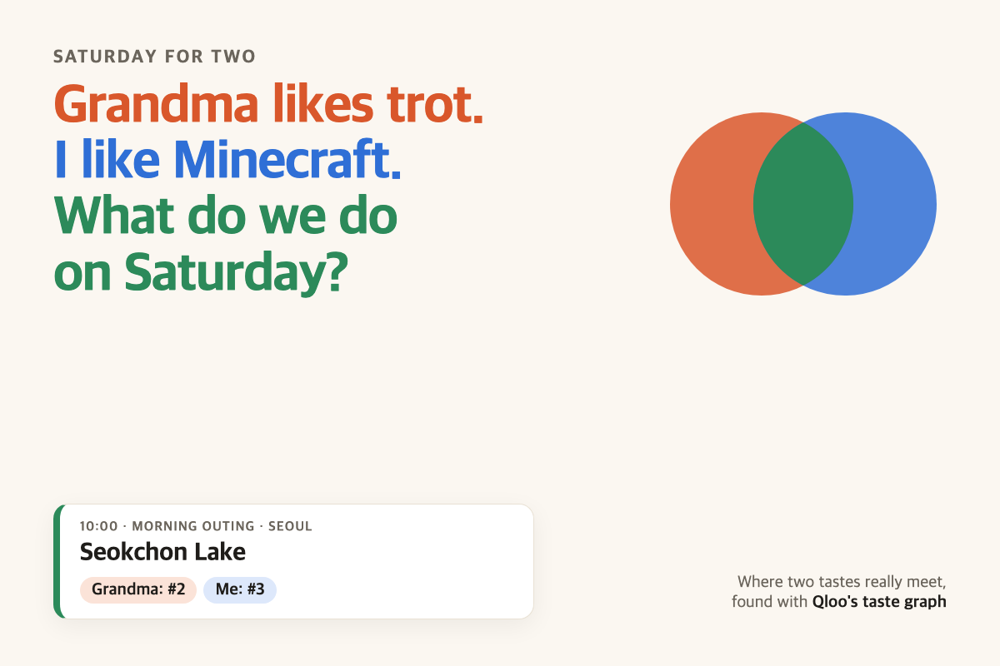

# Saturday for Two

**Grandma likes trot. I like Minecraft. What do we do on Saturday?**

Type what two people love. The agent asks Qloo's taste graph where their tastes really meet, and plans one Saturday around that: a morning outing and a lunch spot in your city, a film, songs for the car, and one episode before bed. Every pick shows where it sits in *each* person's own Qloo list. When nothing meets, it says so and you take turns.



- Live demo: **(link added when the owner publishes it — see "Hosting")**
- Demo video: **(YouTube link added on upload)**
- Built for the [Qloo Agentic Hackathon 2026](https://qloo.devpost.com/) by Jeonggil Bae (MoaHub, Korea). MIT licence.

## Why this needs Qloo

A language model asked "what should a trot-loving grandma and a Minecraft kid do together?" will write something that sounds nice. It cannot tell you whether that film is actually high on *both* lists, or whether nothing is. That needs a taste graph that scores every candidate for each person separately. Without Qloo, this app has nothing to compute.

What we measured with the live Qloo hackathon API (8 fixed pairs × 5 parts of the day, details in [docs/measurements.md](docs/measurements.md)):

| | Places (outing + lunch) | Films, artists, shows |
|---|---|---|
| Parts of the day where something is in **both** people's lists | 16 of 16 | 14 of 24 |
| The obvious approach (one Qloo call with both people's favourites mixed) picks something **outside** at least one person's list | 9 of 16 | 17 of 24 |
| When something is shared: median of the worse of the two ranks, agent pick vs mixed-call pick ("outside the list" counted as just past its end) | #11 vs #101 | #71 vs #199 |

Two things we did not expect:

- **Music is where people split.** In 7 of 8 pairs there was not one artist in both people's top 200. So the car playlist takes turns.
- **Places are where people meet.** Every pair had places in both top-100 lists, often a lot of them (for a trot fan and a Minecraft kid in Seoul: 41).

Mixing everyone's favourites into one query is not a compromise: one person's taste usually drowns out the other. In the Seoul example, the mixed call's lunch pick is #9 for the kid and outside Grandma's top 100. The agent's pick is #9 for Grandma and #10 for the kid.

What these numbers do **not** show: whether real families enjoyed the day. They show where each pick sits in Qloo's lists for each person. We have not run a user study.

## Try it

1. Open the demo, press **Grandma & grandkid · Seoul** (or type your own two people).
2. Watch the agent's steps stream in (about 14 seconds and about 60 Qloo calls; the key allows 10 calls a second, so it paces itself).
3. Read the plan. Each card shows:
   - **Grandma: #9 · Me: #10** — where the pick sits in each person's own Qloo list.
   - **Pulled in by …** — Qloo's `feature.explainability`: how much each favourite contributed.
   - **Mixing everyone's likes into one Qloo call would have picked …** — the naive answer and its two ranks, so you can see the difference.
   - **Grandma's turn / Me's turn** — when nothing overlaps.
4. Open **Show the agent's work** for every Qloo call it made, with parameters (the key is never sent to the browser).

## What the agent does, step by step

1. **Finds each favourite in Qloo** with `/search`. If the best match has no taste data, it tries the next match and says so. (This is real: in the hackathon API, Lim Young-woong's *artist* entity has no taste data while his *person* entity does.)
2. **Gets each person's own list** for each part of the day with `/v2/insights`, using `signal.demographics.age` when an age band is given:
   - outing: `urn:entity:place` with `filter.location.query`, `filter.tags` (museum, park, aquarium, zoo, amusement park, botanical garden, science museum) and `filter.hours=Saturday`; top 100
   - lunch: places tagged restaurant, open Saturday; top 100
   - film, artists, show: `urn:entity:movie`, `artist`, `tv_show`; top 200 (four pages); with a child coming, `filter.content_rating` = G/PG
3. **Builds a candidate pool**: items in both lists first, then each person's top 12, then the mixed call's results (up to 50, Qloo's limit).
4. **Scores every candidate for each person separately** with `filter.results.entities`, and places it inside that person's own list. Qloo returns the same affinity for a person and an item regardless of other filters, which is what makes this placement possible.
5. **Chooses**: shared only if the item is in both lists, best *worse* rank wins. If there is nothing shared, each person gets a turn: from their own top 10, the item the other person minds least.
6. **Explains** with `feature.explainability` and the item's Qloo tags (genre, cuisine, mood, "good for kids" and so on; payment cards and raw keywords are filtered out).

No language model is in this loop. That is a choice: every name in the plan is a Qloo entity, so the plan cannot invent a restaurant or a film. The "agent" is the part that decides which Qloo calls to make, recovers when a call is empty or rate-limited, judges whether an overlap is real, and switches to taking turns when it is not.

### Use it from your own agent (MCP)

`mcp/server.mjs` is a small MCP server (stdio, no dependencies) with one tool, `plan_shared_saturday`. Any MCP client (for example Claude Desktop) can call it:

```json
{ "mcpServers": { "saturday-for-two": { "command": "node", "args": ["--env-file=/path/to/.env.local", "/path/to/mcp/server.mjs"] } } }
```

It returns a short text plan plus the full JSON (ranks, explainability, the mixed-call comparison).

## Run it locally

Needs Node.js 20 or newer and a Qloo hackathon key. No `npm install` is needed (no dependencies).

```sh
cp .env.example .env.local      # put your key in .env.local
npm run dev                      # http://127.0.0.1:5173
npm test                         # 11 unit tests, no network
npm run measure                  # re-runs the measurements (about 480 Qloo calls)
```

## Hosting

The page is static (`public/`) and the planner is one serverless function (`api/plan.js`), so it runs on Vercel's free tier: import the repository, set `QLOO_API_URL` and `QLOO_API_KEY` as environment variables, deploy. `npm start` also runs it on any Node host (`HOST=0.0.0.0`).

The key stays on the server: the browser only talks to `/api/plan`, and the call log shown in the page has no key in it. To protect the shared quota (50,000 calls a month on a hackathon key), the server caches Qloo responses and finished plans for 6 hours, allows 8 plans per connection per 10 minutes and 300 new plans a day per server instance. Cached plans are labelled as cached.

## Files

- `lib/agent.mjs` — the planner
- `lib/qloo.mjs` — Qloo client: key in a header only, pacing under the per-second limit, retries on 429
- `lib/handler.mjs`, `api/plan.js`, `server.mjs` — streaming endpoint (newline-delimited JSON) for the hosted function and the local server
- `public/` — the web page (plain HTML, CSS and JavaScript)
- `mcp/server.mjs` — MCP tool
- `scripts/measure.mjs`, `docs/measurements.md` — measurements. Raw Qloo responses are written to `measurements-raw/`, which is git-ignored: the Qloo FAQ asks not to publish response data in a repository.

## Limits

- Qloo knows some places and people better than others. Korean place names often come back in Korean (the card adds Qloo's English description when there is one). Trot as a *genre* is not a Qloo entity, so type an artist instead.
- "Shared" means "in both people's Qloo top 100 (places) or top 200 (films, artists, shows)". It is a statement about Qloo's lists, not a guarantee anyone will like it.
- About 14 seconds per new plan, set by the API's 10-calls-a-second limit.
- The abuse limits are in memory, so they are per server instance, not global.
- Restaurants are what Qloo tags as restaurants and open on Saturday; we do not check bookings, prices or opening hours beyond that.

## Built during the hackathon

Everything here was written from 27 October 2026, during the submission period. The idea came from a planning note on how to use taste data for a *decision* rather than a list.
